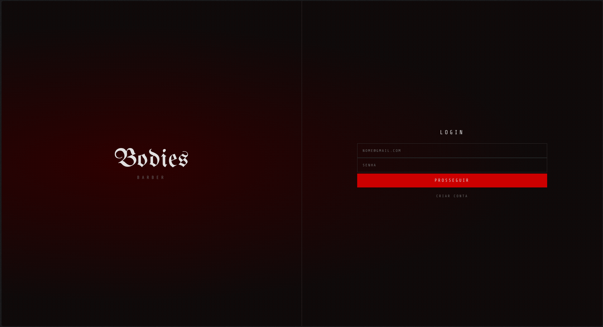
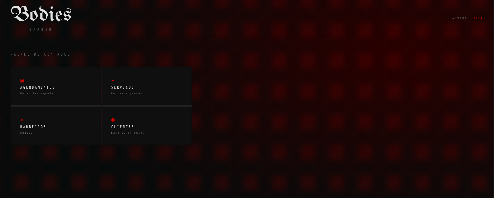
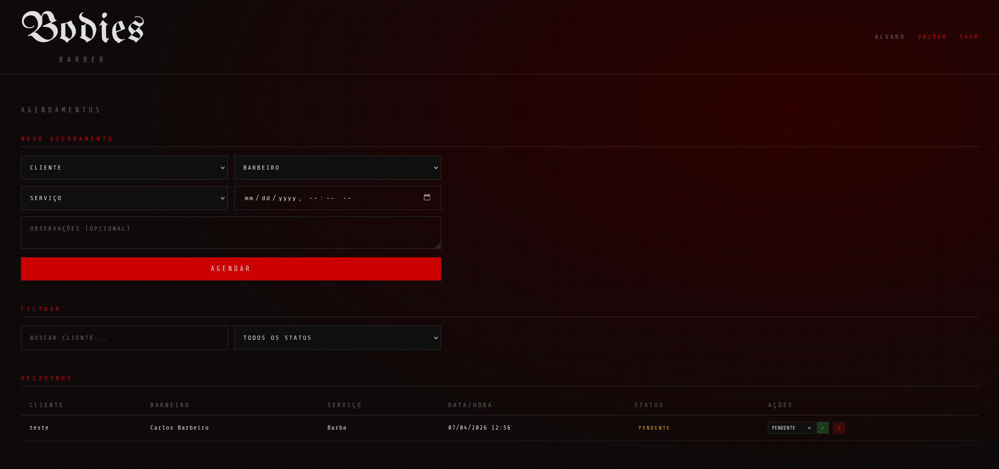
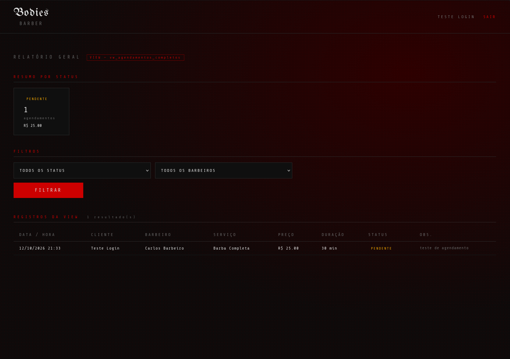
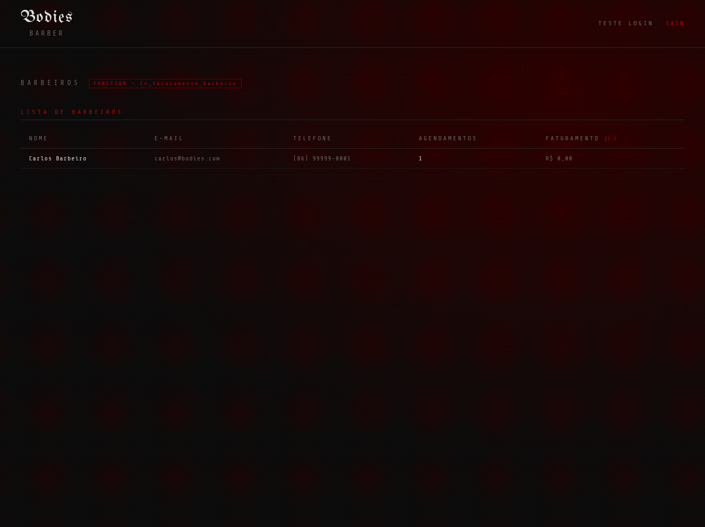

# Sistema de Agendamento para Barbearia — Bodies Barber

Projeto prático da disciplina de **Banco de Dados (2ª Nota)** — Centro Universitário Santo Agostinho (UNIFSA).

Sistema web de agendamento para barbearia que demonstra integração completa com **Supabase** (PostgreSQL na nuvem) e **Redis** (cache), além de operações CRUD, consultas com JOIN, **VIEW**, **FUNCTION** e **PROCEDURE** implementadas no banco.

---

## 🌐 Acesso Online

> **O sistema está publicado e pode ser acessado diretamente pelo navegador, sem instalação.**

[](https://sistemacrud-barbearia.onrender.com)

### 🔑 Credenciais de Teste

| E-mail | Senha | Perfil |
|---|---|---|
| admin@bodies.com | senha123 | admin |
| carlos@bodies.com | senha123 | barbeiro |

> ⚠️ O serviço está hospedado no plano gratuito do Render — pode demorar ~30s para carregar na primeira visita (cold start).

---

## 🎯 Objetivo e Funcionalidades

O sistema resolve o problema de gerenciamento manual de agendamentos em barbearias. Clientes precisam ligar ou ir presencialmente para marcar horários, e o barbeiro não tem visibilidade em tempo real da sua agenda e do seu faturamento.

**Funcionalidades implementadas:**
- Autenticação com três perfis: admin, barbeiro e cliente
- CRUD completo de agendamentos, barbeiros, clientes e serviços
- Confirmação de agendamentos via **PROCEDURE** no banco (`sp_confirmar_agendamento`)
- Relatório de agendamentos usando **VIEW** consolidada (`vw_agendamentos_completos`)
- Faturamento por barbeiro usando **FUNCTION** no banco (`fn_faturamento_barbeiro`)
- Cache de consultas custosas com **Redis** para melhorar a performance

---

## 🛠️ Tecnologias


| Camada | Tecnologia |
|---|---|
| Backend | Python 3 + Flask |
| Banco de dados | PostgreSQL 17 (Supabase) |
| Driver | psycopg2 |
| Cache | Redis (Render Key Value) |
| Interface | Web (Flask + HTML/CSS) |
| Deploy | Render (gunicorn) |

---

## 📂 Estrutura

```
SistemaCRUD_Barbearia/
├── database/
│   ├── views/       vw_agendamentos_completos.sql
│   ├── functions/   fn_faturamento_barbeiro.sql
│   └── procedures/  sp_confirmar_agendamento.sql
├── ddl/             databasePGSQL.sql
├── dml/             inserts.sql
├── dql/             queries.sql
├── docs/            prints do sistema
└── src/
    ├── app.py
    ├── cache.py
    ├── database.py
    ├── requirements.txt
    ├── templates/
    └── static/
```

---

## 🗃️ Integração com Supabase

O Supabase é utilizado como banco de dados **PostgreSQL 17 hospedado na nuvem**. A conexão é feita via **Connection Pooler** (porta 6543) com `psycopg2`, o que permite múltiplas conexões simultâneas sem sobrecarregar o banco.

**O que está implementado no Supabase:**

| Objeto | Nome | Descrição |
|---|---|---|
| Tabelas | `usuarios`, `agendamentos`, `servicos` | Estrutura principal do sistema |
| VIEW | `vw_agendamentos_completos` | Consolida dados de agendamento com JOIN entre 3 tabelas |
| FUNCTION | `fn_faturamento_barbeiro(uuid)` | Calcula total faturado por barbeiro (status `concluido`) |
| PROCEDURE | `sp_confirmar_agendamento(uuid)` | Confirma agendamentos pendentes com validação no banco |

A VIEW é consultada na rota `/relatorio` para exibir todos os agendamentos com nome de cliente, barbeiro e serviço sem repetir JOINs no código Python. A FUNCTION é chamada individualmente para cada barbeiro na rota `/barbeiros`. A PROCEDURE substitui um UPDATE simples na confirmação de agendamentos, garantindo que apenas agendamentos com status `pendente` possam ser confirmados.

---

## ⚡ Cache com Redis

### Por que o Redis foi utilizado?

A rota `/barbeiros` tem um problema de **N+1 queries**: para cada barbeiro listado, o sistema precisa chamar a FUNCTION `fn_faturamento_barbeiro` no banco. Com 10 barbeiros, são 11 consultas a cada acesso à página. O Redis resolve esse problema guardando o resultado já processado por 5 minutos.

A rota `/relatorio` consulta a VIEW e ainda agrega totalizadores por status — uma operação que varre toda a tabela de agendamentos. Sem cache, esse custo é repetido a cada visita ao relatório.

### Como foi implementado?

O módulo `src/cache.py` encapsula a conexão com Redis e expõe três funções simples: `cache_get`, `cache_set` e `cache_delete`. Se o Redis estiver indisponível (variável `REDIS_URL` ausente ou serviço fora do ar), o sistema continua funcionando normalmente — o fallback vai direto ao banco.

| Chave | Rota cacheada | TTL | Motivo |
|---|---|---|---|
| `barbeiros_lista` | `GET /barbeiros` | 5 min | Evita N+1 queries à FUNCTION por barbeiro |
| `relatorio_totais` | `GET /relatorio` (totalizadores) | 5 min | Evita varredura completa da VIEW a cada acesso |

**Invalidação automática:** sempre que um agendamento é criado, atualizado ou deletado, ambas as chaves são removidas do cache — garantindo que os dados exibidos reflitam o estado real do banco.

```python
# Exemplo de uso em app.py
barbeiros_com_fat = cache_get("barbeiros_lista")
if barbeiros_com_fat is None:
    # ... consulta ao banco + chamadas à FUNCTION ...
    cache_set("barbeiros_lista", barbeiros_com_fat, ttl=300)
```

---

## 🗄️ Recursos Avançados do Banco

### VIEW — `vw_agendamentos_completos`
Consolida agendamentos, clientes, barbeiros e serviços em uma única consulta. Usada na rota `/relatorio`.

```sql
SELECT * FROM vw_agendamentos_completos;
```

### FUNCTION — `fn_faturamento_barbeiro(uuid)`
Retorna o total faturado por um barbeiro (agendamentos com status `concluido`). Usada na rota `/barbeiros`.

```sql
SELECT fn_faturamento_barbeiro('<uuid do barbeiro>');
```

### PROCEDURE — `sp_confirmar_agendamento(uuid)`
Confirma um agendamento pendente com segurança. Chamada ao confirmar agendamentos na rota `/agendamentos`.

```sql
CALL sp_confirmar_agendamento('<uuid do agendamento>');
```

---

## 🚀 Como Executar Localmente

**Pré-requisitos:** Python 3.10 ou superior instalado.

### 1. Clone o repositório
```bash
git clone https://github.com/JeytheJo/SistemaCRUD_Barbearia.git
cd SistemaCRUD_Barbearia
```

### 2. Instale as dependências
```bash
pip install flask psycopg2-binary python-dotenv gunicorn redis
```

> No Linux/Fedora, se necessário: `pip install --break-system-packages flask psycopg2-binary python-dotenv gunicorn redis`

### 3. Configure as variáveis de ambiente

Crie o arquivo `src/.env` com as credenciais do Supabase:

```env
DB_HOST=db.XXXXXXXXXXXXXXXX.supabase.co
DB_PORT=5432
DB_NAME=postgres
DB_USER=postgres
DB_PASSWORD=sua_senha_aqui

# Opcional — o sistema funciona sem Redis (fallback direto ao banco)
REDIS_URL=redis://localhost:6379

# Opcional — chave de sessão Flask (padrão funciona para dev)
SECRET_KEY=troque_por_uma_chave_forte_em_producao
```

> As credenciais do banco estão em: **Supabase → Settings → Database → Connection parameters**

### 4. Execute
```bash
cd src
python app.py
```

### 5. Acesse no navegador
```
http://127.0.0.1:5000
```

---

## 📸 Telas do Sistema

### Login


### Dashboard


### Agendamentos (CRUD + PROCEDURE)


### Relatório (VIEW)


### Barbeiros (FUNCTION + Cache Redis)


---

## 📺 Vídeo Demonstrativo

👉 [Link dos Vídeos](https://drive.google.com/drive/folders/16qDwOs1r1ixPjSzbXb0cB2LOPHd7gLlG?usp=sharing)


---

## 👤 Autor

**João Eduardo** — [@JeytheJo](https://github.com/JeytheJo)  
Centro Universitário Santo Agostinho — UNIFSA  
Disciplina: Banco de Dados — Prof. Anderson Costa